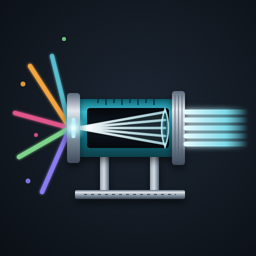

<p align="center">
  
</p>

<h1 align="center">Collimo</h1>

<hr/>

**col·lì·mo** *Italian, verb*
I line it up. A collimator is the part of an optical instrument that lines the light up so it runs true.

[](https://github.com/collimohq/collimo-deploy/releases)
[](https://github.com/orgs/collimohq/packages)
[](#what-you-need)
[](https://docs.collimo.dev)
[](#help-and-feedback)

*Monitoring for UniFi networks, the hypervisors and storage beside them, and the internet connection they all depend on.*

- **What the vendor screens bury:** fan speeds, per-port errors, SFP optics, PoE draw, temperatures, NVR disk health.
- **An outage record that outlives the controller,** with the evidence for whose fault it was.
- **Hypervisors and storage on the same page:** vCenter, Proxmox VE and Ceph, XCP-ng (preview), PBS, Synology, QNAP, TrueNAS.
- **Other makers' gear too:** managed switches, UPSes and PDUs over SNMP, servers through their BMC over Redfish, and an up-check for anything with an address.
- **Alerts that mean something now,** not counters from two years ago.
- **Two containers, nothing built on your host,** set up from a wizard in the browser.

**For homelabs:** you have a rack, a UniFi network, a hypervisor or three and a NAS, and you want one page that says what's wrong and where. Collimo draws your rack: each switch as its front panel, each port lit for its speed, so a port outlined in red on screen is where your finger goes on the rack.

**For small businesses and MSPs:** you need receipts. When the ISP says "it's your equipment", Collimo's outage archive shows when the WAN went down, for how long, whether the modem rebooted, and what the modem blamed. Read-only accounts everywhere: Collimo watches and tells you, and changes nothing.

> [!IMPORTANT]
> **Collimo is in private beta.** It runs only with a license key from us, and watches nothing without one. Want in? Ask for a key on the [Collimo Discord](https://discord.collimo.dev): [how to ask](https://docs.collimo.dev/start/beta-key/).


## Contents

- [What it watches](#what-it-watches)
- [How it works](#how-it-works)
- [What you need](#what-you-need)
- [Install](#install)
- [Updating](#updating)
- [Alerts and notifications](#alerts-and-notifications)
- [Editions](#editions)
- [Help and feedback](#help-and-feedback)

## What it watches

| Source | What Collimo reads | Set it up |
|---|---|---|
| **UniFi Network** | Fan speeds, temperatures, per-port errors and link speeds, SFP optics, PoE draw, Wi-Fi radios and the channel plan, both WAN links, the cable modem, speed tests, outage history | [Guide](https://docs.collimo.dev/connect/unifi-network/) |
| **UniFi Protect** | Every camera's state, the recorder's disks and their health, its CPU temperature, each camera's throughput | [Guide](https://docs.collimo.dev/connect/unifi-protect/) |
| **VMware vCenter and ESXi** | Hosts, maintenance mode, CPU, memory, ESXi build; datastores; VM power state and the busiest VMs; vCenter's alarms | [Guide](https://docs.collimo.dev/connect/vcenter/) |
| **XCP-ng** (preview, through Xen Orchestra) | Every pool's hosts, storage repositories, the busiest VMs, and Xen Orchestra's alarms | [Guide](https://docs.collimo.dev/connect/xcpng/) |
| **Proxmox VE and Ceph** | Nodes, quorum, storage use, guests and the busiest of them, Ceph health | [Guide](https://docs.collimo.dev/connect/proxmox/) |
| **Proxmox Backup Server** | The backup server's health and capacity: datastore use and its own fill estimate, the past week's jobs, when each machine was last backed up | [Guide](https://docs.collimo.dev/connect/pbs/) |
| **Synology DSM** | Model, DSM version, CPU, memory, temperature; volumes and RAID; drives and their SMART verdicts | [Guide](https://docs.collimo.dev/connect/synology/) |
| **QNAP** (SNMPv3) | CPU, memory, temperatures and fans; disks and M.2 drives; storage pools | [Guide](https://docs.collimo.dev/connect/qnap/) |
| **TrueNAS** | Pools, disk read, write and checksum errors, temperatures, TrueNAS's own alerts | [Guide](https://docs.collimo.dev/connect/truenas/) |
| **Managed switches** (SNMP) | Cisco, Juniper, Aruba, MikroTik and others: ports, speeds, errors, VLANs, temperatures and fans, LLDP neighbours; on Cisco and Juniper also CPU, memory, power supplies, optics and chassis alarms | [Guide](https://docs.collimo.dev/connect/snmp-switches/) |
| **UPS** (SNMP) | On mains or battery, charge, runtime left, load, voltages, battery alarms | [Guide](https://docs.collimo.dev/connect/ups/) |
| **PDUs** (SNMP) | APC, Raritan and Eaton: draw against the rating, banks, and each outlet | [Guide](https://docs.collimo.dev/connect/pdu/) |
| **Servers** (Redfish) | Dell iDRAC, HPE iLO, Supermicro, Lenovo XCC: health, temperatures, fans, power supplies, drives | [Guide](https://docs.collimo.dev/connect/redfish/) |
| **phpIPAM and NetBox** | Free addresses, racks and outlets, for capacity planning to check against | [Guide](https://docs.collimo.dev/connect/ipam/) |
| **Anything else** | Up-checks by ping, HTTP or TCP: is it answering, and how quickly | [Guide](https://docs.collimo.dev/connect/up-checks/) |

No UniFi? Collimo can watch only your servers and storage. See [Watching without UniFi](https://docs.collimo.dev/connect/without-unifi/).

<table>
<tr>
<td width="50%"><br><sub><b>The front panel.</b> Odd ports on top, even below, SFP cages to the right, each lit for its speed. A red outline means errors climbing now; a dashed amber one, slower than that port has run.</sub></td>
<td width="50%"><br><sub><b>The modem.</b> Why it last re-initialised, and whether it rebooted through an outage.</sub></td>
</tr>
<tr>
<td width="50%"><br><sub><b>The outage ledger.</b> Every outage, its cause, and availability with how much of the window the archive covers.</sub></td>
<td width="50%"><br><sub><b>Virtualization and storage.</b> Hosts, guests, pools and disks beside the network.</sub></td>
</tr>
</table>

## How it works

```
  UniFi consoles     vCenter · Proxmox · PBS      Synology · QNAP · TrueNAS
        \                     |                          /
         \______  read-only accounts, polled  _________/
                              |
                     +------------------+        +--------------------+
                     |     collimo      | -----> |  VictoriaMetrics   |
                     |  collector, UI,  |  push  |  history, graphs   |
                     |  outage archive  |        +--------------------+
                     +------------------+
                         |          |
             dashboard on :8090    alerts: Gotify, ntfy, Pushover, Discord, email, ...
```

- **`collimo`** reads your equipment, keeps the outage archive and serves the dashboard and `/metrics`.
- **`collimo-victoria-metrics`** stores the history behind the graphs.
- Both keep their data on Docker volumes. Nothing is written to the host's own folders, and redeploying never loses anything.

## What you need

- A Docker host with **Portainer** or **Docker Compose**, amd64 or arm64, with outbound internet access to download the images.
- At least one thing to watch from the table above.
- A **read-only account** on each. The wizard links to the steps for every system.
- **Your beta license key.** During the private beta Collimo needs one to run; the wizard asks for it. Ask for one on the [Collimo Discord](https://discord.collimo.dev): see [Get a beta key](https://docs.collimo.dev/start/beta-key/).

## Install

You don't type any settings here. Collimo opens a setup wizard in your browser, asks for them, and writes them for you.

**1. Create the stack.**

<details open>
<summary><b>Portainer</b></summary>

1. **Stacks → Add stack.** Name it `collimo`.
2. **Build method:** Repository.

   | Field | Value |
   |---|---|
   | Repository URL | `https://github.com/collimohq/collimo-deploy` |
   | Repository reference | `refs/heads/main` |
   | Compose path | `docker-compose.yml` |
   | Authentication | **off** |

3. Leave **Environment variables** empty, and click **Deploy the stack**.

</details>

<details>
<summary><b>Docker Compose</b></summary>

```sh
git clone https://github.com/collimohq/collimo-deploy.git collimo
cd collimo
docker compose up -d
```

Keep this folder: your settings go in a `.env` file here.

</details>

**2. Open `http://<your docker host>:8090`.** With nothing configured, Collimo opens its setup wizard.

**3. Follow the wizard.** It tests each connection as you go, and at the end gives you `collimo.env` and the steps to load it into the stack.

**4. Your key** goes in on the wizard's License step. To change it later, use **Settings → License**.

Full walkthrough: [Install](https://docs.collimo.dev/start/install/) and [The setup wizard](https://docs.collimo.dev/start/setup-wizard/).

> [!NOTE]
> Collimo's containers have fixed names, so run one Collimo per Docker host. To run a test copy beside a live one, see [Running beside another stack](https://docs.collimo.dev/run/beside-another-stack/).

## Updating

When a release comes out, set `COLLIMO_VERSION` to it, then **Pull and redeploy** in Portainer, or run `docker compose up -d`. Nothing changes until you do. Releases are listed under [Releases](https://github.com/collimohq/collimo-deploy/releases).

## Alerts and notifications

Every alert is worked out in Collimo, so the dashboard, the notifications and `/metrics` always agree. Rules set the lowest severity to send per tab or per alert; an alert must hold for a delay before it's sent; quiet hours hold warnings; and maintenance mode keeps planned work from paging anyone.

| Channel | Edition |
|---|---|
| Gotify, ntfy, Pushover, Discord, email | All |
| Slack, Microsoft Teams, PagerDuty, webhook, Apprise | Paid |

Details: [Alerts](https://docs.collimo.dev/use/alerts/).

## Editions

Collimo will come as **Community** and paid editions, **Business** and **MSP**. The paid editions add sign-in with users and roles, inventory reports, capacity planning, the VMware exit report, alert thresholds and more. During the private beta every install runs on a beta key, with everything on. What each edition has is on [Editions](https://docs.collimo.dev/reference/editions/). Pricing will be announced.

## Help and feedback

- 📖 **Documentation:** <https://docs.collimo.dev>, including [Troubleshooting](https://docs.collimo.dev/troubleshooting/)
- 💬 **Discord:** beta keys, questions and chat on the [Collimo Discord](https://discord.collimo.dev)
- 🐛 **Bugs and feature requests:** [open an issue](https://github.com/collimohq/collimo-deploy/issues/new/choose)
- ✉️ **Anything else:** <feedback@collimo.dev>
- 📄 **Full deployment reference:** [PORTAINER.md](PORTAINER.md)

Your license key is checked once a day against a signed list at `https://license.collimo.dev/revoked`. That's a plain download: nothing about you, your network or your install is sent.

Every image carries its software bill of materials (CycloneDX) at `/sbom.cdx.json`, and each release adds it here under `sbom/`. Security problems: see [Reporting a security problem](https://docs.collimo.dev/reference/security/).

---

Collimo and the Collimo logo are trademarks of COLLIMO LLC. © 2026 COLLIMO LLC. All rights reserved.

UniFi, UniFi Protect and UniFi OS are trademarks of Ubiquiti Inc. VMware, vCenter and ESXi are trademarks of Broadcom Inc. and its subsidiaries; XCP-ng and Xen Orchestra of Vates SAS; Proxmox of Proxmox Server Solutions GmbH; Synology, QNAP, TrueNAS and the other products named here of their respective owners. They are named only to describe what Collimo reads from, runs on, or sends to. Collimo is an independent project and is not affiliated with, sponsored by, or endorsed by any of them. See [LICENSE](LICENSE) for the terms.
